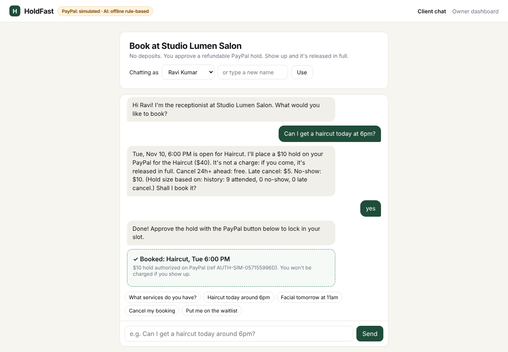
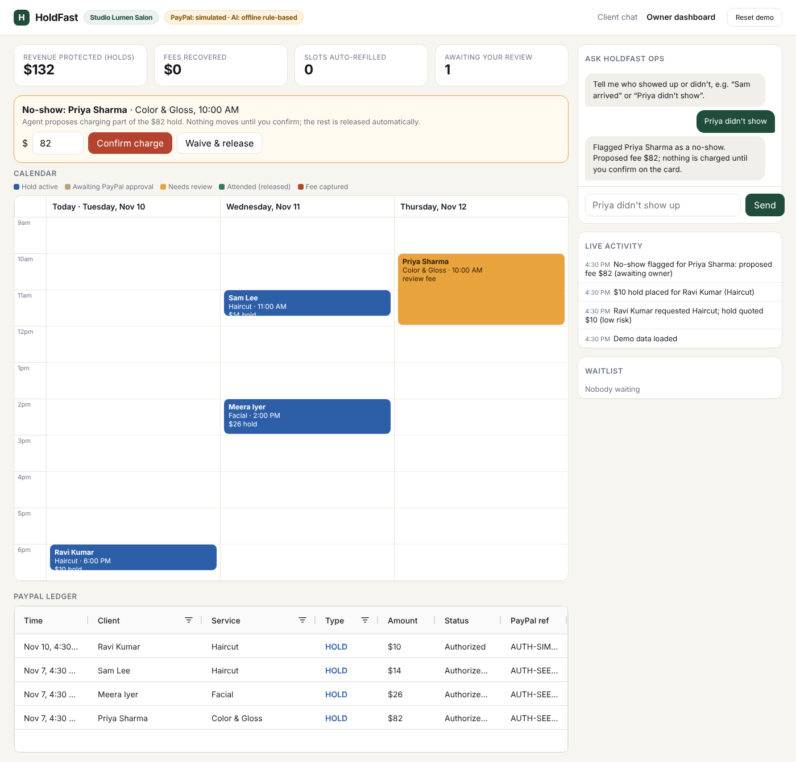

# HoldFast: the AI receptionist that ends no-shows

**No deposits. No empty chairs.** HoldFast books appointments over chat and, instead of taking money upfront, places a **refundable PayPal authorization hold** sized to the booking's no-show risk.

- Client shows up → hold **voided**, they pay nothing extra.
- Late cancel / no-show → the agent **proposes** a fee; the owner confirms → **partial capture**, remainder released.
- Someone cancels → the agent instantly **offers the slot to the waitlist** with a fresh hold. The calendar heals itself.

Built for the PayPal AI Hackathon 2026.




## Why

Appointment businesses (salons, tutors, physios, photographers) lose revenue to no-shows. Upfront deposits scare off good clients; no deposit means empty chairs. HoldFast uses PayPal's **authorize → capture/void** lifecycle so reliable clients are never charged, and only risk is priced.

## How PayPal is used

| Step | PayPal API |
|---|---|
| Agent books a slot | `POST /v2/checkout/orders` with `intent: AUTHORIZE`, amount = risk-sized hold |
| Client approves in chat | PayPal JS SDK Buttons (`intent=authorize`) |
| Hold placed | `POST /v2/checkout/orders/{id}/authorize` |
| Attended / free cancel / waived | `POST /v2/payments/authorizations/{id}/void` |
| Owner confirms fee | `POST /v2/payments/authorizations/{id}/capture` with partial `amount` + `final_capture: true` (releases the remainder) |
| Bookings > 3 days out | `POST /v2/payments/authorizations/{id}/reauthorize` (honor period) |
| Ledger sync | Webhooks + `POST /v1/notifications/verify-webhook-signature` |

All calls use `PayPal-Request-Id` idempotency keys.

## How AI is used

- **Receptionist agent** (Claude, tool use): `list_services`, `check_availability`, `quote_hold`, `book_appointment`, `my_bookings`, `cancel_booking`, `join_waitlist`. It must quote the hold and fee policy in plain words before booking.
- **Ops agent** (Claude, tool use) for the owner: "Priya didn't show" → `flag_no_show`; "Sam arrived" → `mark_attended`.
- **Human in the loop:** no agent tool can capture money. Captures only happen through the owner's **Confirm charge** button.
- **Risk scoring with explanations:** the hold is 20–100% of price, capped at the price, based only on booking behaviour with this business (attendance history, lead time, slot time). No names, demographics, location or device data. Owners can open any booking and see exactly why the hold is that size.
- Without an `ANTHROPIC_API_KEY`, an offline rule-based agent runs so the app still works.

## Sponsor tools

- **AG Grid Community**: the PayPal ledger (sortable, filterable holds/captures/releases).
- **Render**: one-click deploy via `render.yaml`.

## Run it

```bash
git clone <this repo> && cd holdfast
npm install
cp .env.example .env     # add PayPal sandbox + Anthropic keys (optional: runs simulated without them)
npm start                # http://localhost:3000  (client)  /owner.html  (owner)
npm test                 # end-to-end lifecycle test (simulated PayPal)
npm run paypal:smoke     # verify your sandbox credentials against real PayPal
```

### PayPal sandbox setup (5 min)
1. developer.paypal.com → **Apps & Credentials** → Sandbox → **Create App** → copy Client ID + Secret into `.env`.
2. **Testing Tools → Sandbox Accounts**: use the default *Personal* account to approve holds.
3. (Optional) Add a webhook in the app to `https://<your-host>/api/webhooks/paypal` for `PAYMENT.AUTHORIZATION.*` and `PAYMENT.CAPTURE.*`, put its id in `PAYPAL_WEBHOOK_ID`.

### For judges
- Hosted demo: `<RENDER URL>`
- Sandbox buyer login: `<sandbox personal email>` / `<password>`
- Try: open the client chat as **Priya Sharma** (high risk) vs **Ravi Kumar** (reliable) and ask for the same service. Notice the different holds. Then open the owner dashboard.
- "Reset demo" (owner dashboard, top right) restores seed data.

## Architecture

```
client chat ─▶ /api/chat ─▶ Receptionist agent (Claude tools) ─┐
owner chat  ─▶ /api/owner/chat ─▶ Ops agent (Claude tools) ────┤
owner buttons ─▶ /api/owner/* ─────────────────────────────────┤
                                                               ▼
                         bookings.js (single source of money rules)
                           │ risk.js (explainable hold sizing)
                           ▼
                       paypal.js ─▶ PayPal Orders v2 / Payments v2 / Webhooks
                           │
                       store (JSON) ─▶ SSE ─▶ owner dashboard (calendar + AG Grid)
```

## AI tools used to build this
- Claude: the in-app agents (receptionist + ops) via the Anthropic API.
- Claude: assisted with code scaffolding during development.

## License
MIT
